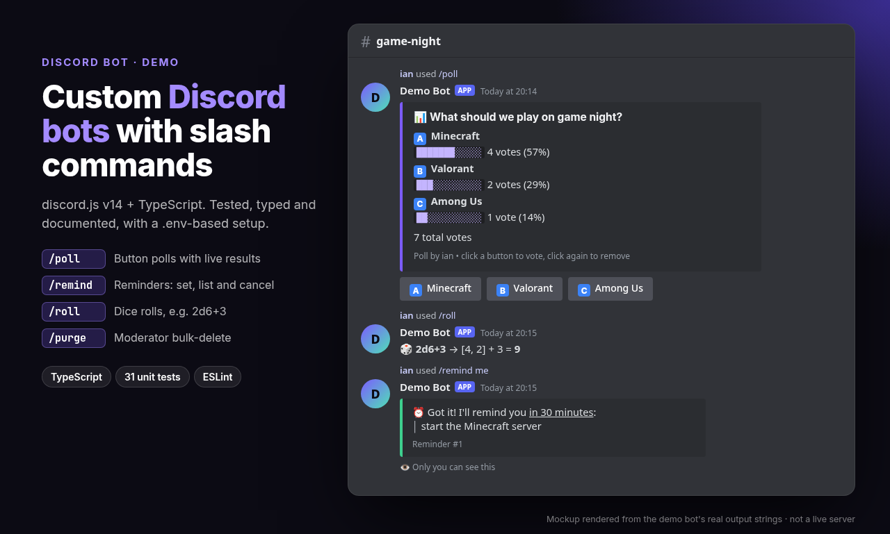

# discord-bot-demo

A small, production-style **Discord bot** written in **TypeScript** with **discord.js v14**.
It's a portfolio demo project by Ian Esquivel ([@esquivel-stuff](https://github.com/esquivel-stuff)) showing how I structure bots: typed commands, pure, unit-tested logic, and a simple `.env` setup.



> The preview image is a mockup rendered from the bot's real output strings, not a screenshot of a live server.

## Commands

| Command | What it does |
| --- | --- |
| `/poll question option1 option2 [..option5]` | Posts a poll with buttons. One vote per user (click again to remove it), with live progress bars. |
| `/remind me in:<10m / 2h / 1d12h> about:<text>` | Sets a reminder (10 s to 7 days, max 5 per user). Also `/remind list` and `/remind cancel id:<n>`. |
| `/roll [dice]` | Rolls dice in standard notation, e.g. `d20`, `2d6+3`, `4d8-1`. |
| `/purge amount:<1-100> [user]` | Moderators only (Manage Messages). Bulk-deletes recent messages and skips pinned messages and anything older than 14 days. |

## Tech

- Node.js 18.17+ · TypeScript (strict) · discord.js 14
- Vitest unit tests for all command logic (`src/lib/*`)
- ESLint (typescript-eslint) + `tsc --noEmit` type checking

## Setup

1. Create an application and bot at <https://discord.com/developers/applications>, then copy the **bot token** and **application ID**.
2. Invite the bot with the `bot` and `applications.commands` scopes (plus *Manage Messages* if you want `/purge`).
3. Configure and run:

```bash
npm install
cp .env.example .env          # then fill in DISCORD_TOKEN, DISCORD_CLIENT_ID (and optionally DISCORD_GUILD_ID)
npm run deploy-commands       # registers the slash commands (instant if DISCORD_GUILD_ID is set)
npm run dev                   # run with auto-reload
# or, for production:
npm run build && npm start
```

## Scripts

| Script | Purpose |
| --- | --- |
| `npm run dev` | Start with `tsx watch` |
| `npm run build` / `npm start` | Compile to `dist/` and run |
| `npm run deploy-commands` | Register slash commands with Discord |
| `npm test` | Run unit tests |
| `npm run lint` / `npm run typecheck` | Lint and type-check |

## Project structure

```
src/
  index.ts            # client setup, interaction routing, error handling
  deploy-commands.ts  # registers slash commands via the REST API
  config.ts           # env loading/validation
  commands/           # one file per slash command
  lib/                # pure logic: dice, durations, polls, reminders, purge (unit-tested)
test/                 # Vitest tests
```

## Notes and limitations

This is a demo. Polls and reminders live in memory, so they're lost when the bot restarts. A real deployment would store them in a database (e.g. SQLite or Postgres).

## License

MIT
